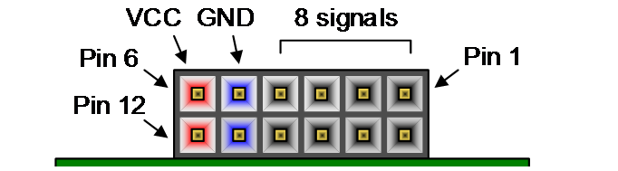

# VIDEO STREAMING

## Overview

A continuous real-time video streaming system on the **Digilent Arty A7-100**
(Xilinx Artix-7 `xc7a100t-csg324-1`). Frames from an **OV7670** camera are
captured, stored in the on-board **DDR3 SDRAM** and streamed to a **VGA**
display at 640×480 (RGB444).

Implemented with:

- **Double buffer (ping-pong) frame storage** in DDR3: the camera writes into
  one frame buffer while the VGA side reads the other, so the display always
  shows a complete frame without tearing.
- **Custom AXI4 masters** for burst write and burst read to the MIG DDR3
  controller.
- **Custom asynchronous FIFOs** for clock domain crossing between the camera,
  memory and VGA clocks, with backpressure handling and their own reset
  synchronizers.
- **Frame Manager** that schedules reads and writes to DDR3 and swaps the
  ping-pong buffers.
- **Frame processing** on the read path (grayscale and thresholding modes,
  selected with the board switches).
- **JTAG to AXI** debug access, so frames stored in DDR3 can be read back to
  the PC for verification.

The Vivado IP blocks used in the block design are documented in
[ip-block-design](ip-block-design/), with one `INFO.md` per IP.

## Folder Structure

```
├── 📁 rtl
├── 📁 tb
├── 📁 verifications
│   ├── 📁 synthetis
│   ├── 📄 ov7670_capture.ipynb
│   ├── 📄 capture_frame.tcl
│   ├── 📄 *.bin
│   └── 📄 *.png
├── 📁 ip-block-design
│   ├── 📁 clocking_wizard
│   ├── 📁 jtag_axi
│   ├── 📁 mig_7_series
│   ├── 📁 proc_sys_reset
│   ├── 📁 smartconnect
│   └── 📁 utility_buffer
├── 📁 xdc
├── 📄 CITATION
├── 📄 LICENSE
└── 📝 README.md
```

### RTL

Verilog source of the custom modules. They implement a **double buffer
(ping-pong) scheme for continuous video streaming**, built from:

- **Custom AXI (Read and Write)**: AXI4 burst masters that write camera
  frames into DDR3 and read them back through the MIG
  ([axi_write.v](rtl/axi_write.v), [axi_read.v](rtl/axi_read.v)). They are
  integrated with the frame executors
  ([write_frame_exec.v](rtl/write_frame_exec.v),
  [read_frame_exec.v](rtl/read_frame_exec.v)), which split one frame into AXI
  bursts. Each pair is wrapped in
  [write_ov7670_frame.v](rtl/write_ov7670_frame.v) and
  [read_ddr_frame.v](rtl/read_ddr_frame.v).
- **Address mapping**: in the Vivado Address Editor, the MIG (DDR3) address
  range must start at `0x0000_0000` and end at `0x0FFF_FFFF` (256 MB) in the
  32-bit address space.
- **Custom Async FIFO**: clock domain crossing FIFO with Gray-code pointers,
  backpressure handling and a custom reset synchronizer for each clock domain
  ([async_fifo.v](rtl/async_fifo.v),
  [attributed_async_fifo.v](rtl/attributed_async_fifo.v),
  [resetn_sync.v](rtl/resetn_sync.v)).
- **Frame Manager**: regulates when frames are written to and read from DDR3
  SDRAM, selects which buffer (A or B) is used by each side and halts safely
  on faults ([frame_manager.v](rtl/frame_manager.v)).

### TB

Simulation testbenches for the modules in [rtl](rtl/):

- **AXI test**: checks the custom AXI write and read masters.
- **Async FIFO test**: checks clock domain crossing, backpressure and reset
  of the custom async FIFO.
- **Frame address test**: checks the addresses generated for writing one
  frame and reading one frame from DDR3.

### Verifications

Hardware verification of a real OV7670 capture stored in DDR3:

- [capture_frame.tcl](verifications/capture_frame.tcl): run in the Vivado
  Hardware Manager to read a captured frame from DDR3 through the JTAG to AXI
  Master and save it to a `.bin` file.
- [ov7670_capture.ipynb](verifications/ov7670_capture.ipynb): converts the
  `.bin` file into an image so the captured frame can be shown.

### XDC

[base.xdc](xdc/base.xdc) holds the pin assignment, I/O standard (LVCMOS33),
clock constraints and CDC constraints of the design. The physical wiring of
the camera and the VGA output on the Pmod connectors is described below.



Each Pmod connector has 12 pins in two rows: pins 1–6 on the top row and pins
7–12 on the bottom row. Looking at the connector from the edge of the board,
**pin 1 (and pin 7) is on the far right**, and **VCC (3.3 V) and GND are the
two pins on the far left**. In the tables below, pin 1–4 means signal pins
JA1–JA4 (top row) and pin 7–10 means signal pins JA7–JA10 (bottom row).

#### OV7670 Camera `[JA and JB]`

The OV7670 module (without FIFO) is wired with jumper cables to **JA** and
**JB**. SCL and SDA use the internal FPGA pull-ups (`PULLTYPE PULLUP` in
[base.xdc](xdc/base.xdc)).

**UPPER JA**

| JA1 | JA2 | JA3 | JA4 | GND | VCC |
| --- | --- | --- | --- | --- | --- |
| SCL (SIOC) | VSYNC | HREF | D7 | GND | 3V3 |

**BOTTOM JA**

| JA7 | JA8 | JA9 | JA10 | GND | VCC |
| --- | --- | --- | --- | --- | --- |
| RESET | D1 | D3 | D5 | – | – |

**UPPER JB**

| JB1 | JB2 | JB3 | JB4 | GND | VCC |
| --- | --- | --- | --- | --- | --- |
| PCLK | SDA (SIOD) | XCLK | D6 | – | – |

**BOTTOM JB**

| JB7 | JB8 | JB9 | JB10 | GND | VCC |
| --- | --- | --- | --- | --- | --- |
| D4 | D2 | D0 | PWDN | – | – |

> The camera is powered from the top row of JA (3V3 and GND). The other
> VCC/GND pins marked "–" are not needed. Do not connect the camera to 5 V.

#### Digilent Pmod VGA `[JC and JD]`

The pin assignment of JC and JD in [base.xdc](xdc/base.xdc) already matches
the **Digilent Pmod VGA**. No jumper cables are needed: plug **Pmod VGA J1
into JC** and **Pmod VGA J2 into JD** directly. VCC and GND are supplied by
the connectors themselves.

**UPPER JC**

| JC1 | JC2 | JC3 | JC4 | GND | VCC |
| --- | --- | --- | --- | --- | --- |
| R0 | R1 | R2 | R3 | GND | VCC |

**BOTTOM JC**

| JC7 | JC8 | JC9 | JC10 | GND | VCC |
| --- | --- | --- | --- | --- | --- |
| B0 | B1 | B2 | B3 | GND | VCC |

**UPPER JD**

| JD1 | JD2 | JD3 | JD4 | GND | VCC |
| --- | --- | --- | --- | --- | --- |
| G0 | G1 | G2 | G3 | GND | VCC |

**BOTTOM JD**

| JD7 | JD8 | JD9 | JD10 | GND | VCC |
| --- | --- | --- | --- | --- | --- |
| HSYNC | VSYNC | – | – | GND | VCC |

## Result

### STA

Results are from the post-route reports of Vivado 2025.2 on
`xc7a100tcsg324-1`.

| WNS | TNS | WHS | THS | WPWS | TPWS |
| --- | --- | --- | --- | --- | --- |
| 1.316 ns | 0.000 ns | 0.050 ns | 0.000 ns | 0.206 ns | 0.000 ns |

All user-specified timing constraints are met, with no failing endpoints. This
covers the 100 MHz system clock, the 200 MHz MIG reference clock, the 25 MHz
camera and VGA clocks and the ≈81.25 MHz MIG `ui_clk`.

### Resource Utilization

| Resource | Used | Available | Utilization |
| --- | ---: | ---: | ---: |
| LUT | 13142 | 63400 | 20.73% |
| FF | 16297 | 126800 | 12.85% |
| BRAM (tile) | 8 | 135 | 5.93% |
| DSP | 0 | 240 | 0.00% |
| IO | 88 | 210 | 41.90% |
| BUFG | 9 | 32 | 28.13% |

### On-Chip Power

| Category | Power | Percentage |
| --- | ---: | ---: |
| Dynamic power | 0.796 W | 88% |
| &emsp;Clocks | 0.050 W | 6% |
| &emsp;Signals | 0.025 W | 3% |
| &emsp;Logic | 0.022 W | 3% |
| &emsp;BRAM | 0.004 W | <1% |
| &emsp;DSP | 0.000 W | 0% |
| &emsp;MMCM | 0.193 W | 24% |
| &emsp;PLL | 0.115 W | 14% |
| &emsp;PHASER | 0.110 W | 14% |
| &emsp;XADC | 0.004 W | <1% |
| &emsp;I/O | 0.273 W | 34% |
| Device static power | 0.106 W | 12% |
| Total On-Chip Power | 0.901 W | 100% |

Dynamic power and device static power are percentages of the total on-chip
power. The indented items are percentages of the dynamic power. The junction
temperature is 29.1 °C. Vivado rates the confidence level of this estimate as
**Low** because no switching activity from simulation was provided.


## Limitations

## Contact

For questions, technical discussions, or additional documentation, feel free to contact me at:

**Email:** alexcinatra.htst@gmail.com

I will be happy to provide clarification and assistance where possible.
