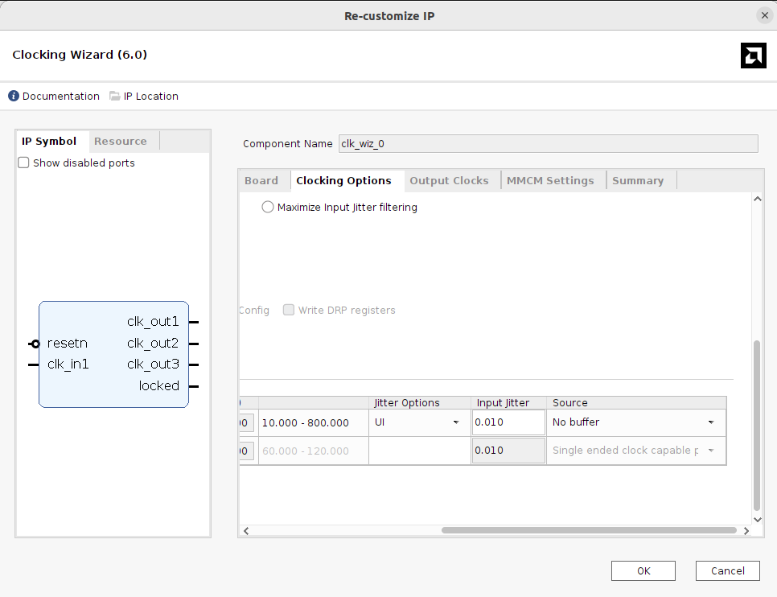
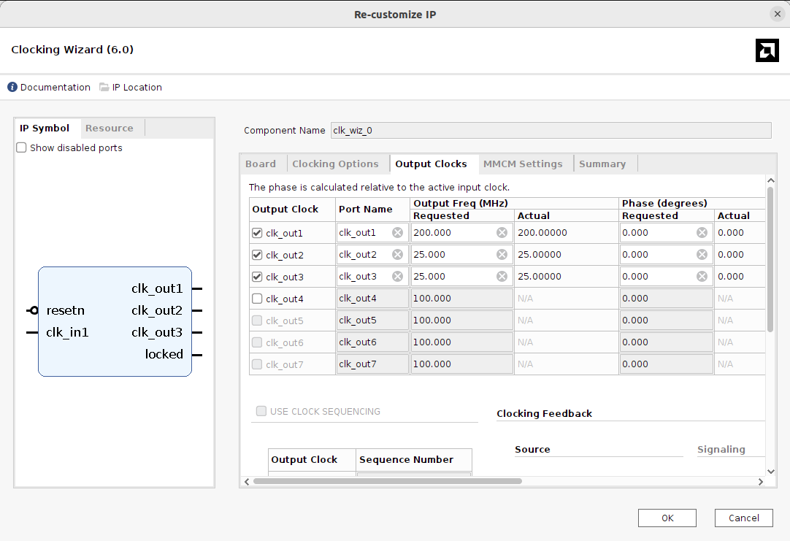
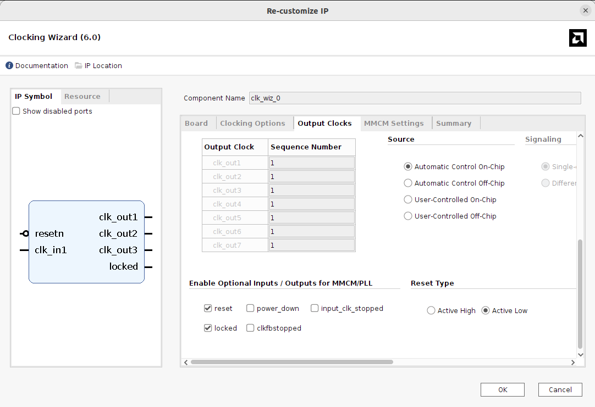

# Clocking Wizard (clk_wiz v6.0)

## Important Setup

### 1. Input clock source: No Buffer

| Parameter | Value |
| --- | --- |
| Primary input clock source | **No buffer** |
| Jitter options | UI |
| Input jitter | 0.010 |

The 100 MHz input clock is already buffered by the **Utility Buffer (BUFG)**,
and the same clock is also used by the MIG. Setting the source to
**No buffer** prevents the Clocking Wizard from inserting another input buffer
on a clock that is already on the global clock network.

### 2. Output clocks

| Output | Port Name | Requested (MHz) | Actual (MHz) | Phase |
| --- | --- | ---: | ---: | ---: |
| clk_out1 | `clk_out1` | 200.000 | 200.000 | 0° |
| clk_out2 | `clk_out2` | 25.000 | 25.000 | 0° |
| clk_out3 | `clk_out3` | 25.000 | 25.000 | 0° |
| clk_out4–7 | — | disabled | — | — |

- **200 MHz (`clk_out1`)**: reference clock for the MIG (`clk_ref_i`). The
  MIG uses it for `IDELAYCTRL`, which requires a 200 MHz reference.
- **25 MHz (`clk_out2`, `clk_out3`)**: clocks for the video side of the
  design (OV7670 camera `XCLK` and the VGA pixel clock for 640×480 @ 60 Hz).

### 3. Optional ports and reset type

| Parameter | Value |
| --- | --- |
| `reset` | enabled |
| `locked` | enabled |
| `power_down`, `input_clk_stopped`, `clkfbstopped` | disabled |
| Reset Type | **Active Low** (`resetn`) |
| Clocking Feedback | Automatic Control On-Chip |

The reset is set to **Active Low** so it matches the board reset button
(`rstn`) and the active-low reset convention used in the rest of the design.
The `locked` output is enabled so downstream logic can be held in reset until
the MMCM output clocks are stable.

## Function

- Generates all fabric clocks that are not produced by the MIG, from a single
  100 MHz input, using one MMCM:
  - 200 MHz reference clock for the MIG DDR3 controller.
  - 25 MHz clocks for the camera and VGA video pipeline.
- Provides the `locked` signal, which indicates that the output clocks are
  stable and can be used as a reset release condition.
- Because the MIG system clock and the Clocking Wizard input come from the
  same 100 MHz source, all generated clocks are related to the MIG `ui_clk`
  (see the CDC constraints in [base.xdc](../../xdc/base.xdc)).

## Connection

### Input Ports

_TBD_

### Output Ports

_TBD_
