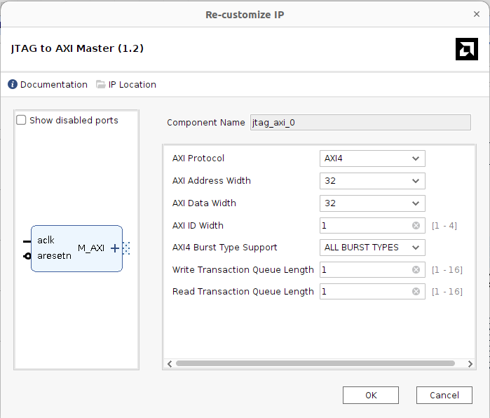

# JTAG to AXI Master (jtag_axi v1.2)

## Important Setup

| Parameter | Value |
| --- | --- |
| AXI Protocol | **AXI4** |
| AXI Address Width | 32 |
| AXI Data Width | 32 |
| AXI ID Width | 1 |
| AXI4 Burst Type Support | **ALL BURST TYPES** |
| Write Transaction Queue Length | 1 |
| Read Transaction Queue Length | 1 |

- **AXI4 with all burst types**: allows burst reads from the PC, so a whole
  frame can be dumped from DDR3 efficiently instead of one word at a time.
- **32-bit address**: covers the full MIG address space.
- **32-bit data**: the SmartConnect converts it to the 128-bit MIG data width.

## Function

- Debug AXI master controlled from the PC through JTAG (Vivado Hardware
  Manager / Tcl, e.g. `create_hw_axi_txn` and `run_hw_axi`).
- Gives direct read/write access to DDR3 without any extra soft processor.
- Used for verification: frames written to DDR3 by the camera pipeline can be
  read back to the PC and checked/rendered (see
  [verifications](../../verifications/)).

## Connection

### Input Ports

_TBD_

### Output Ports

_TBD_
