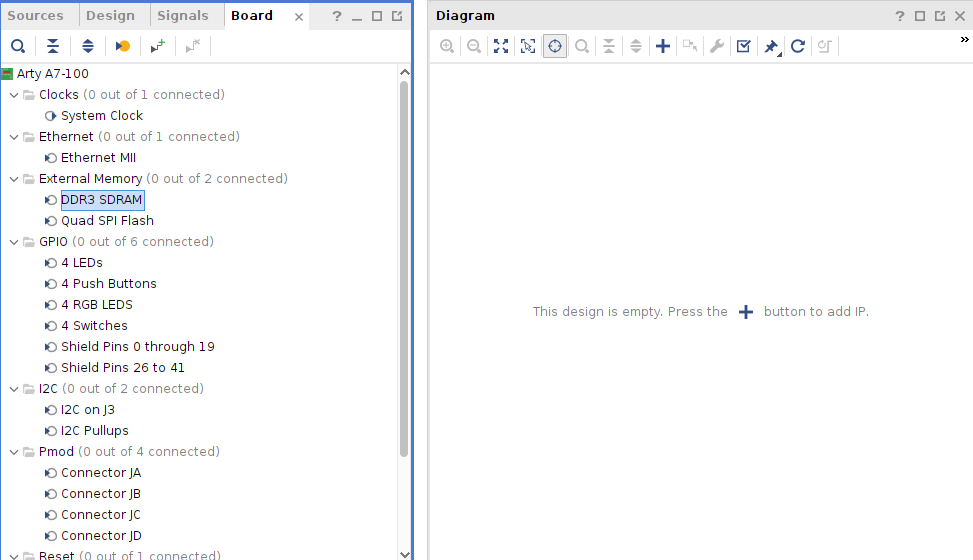
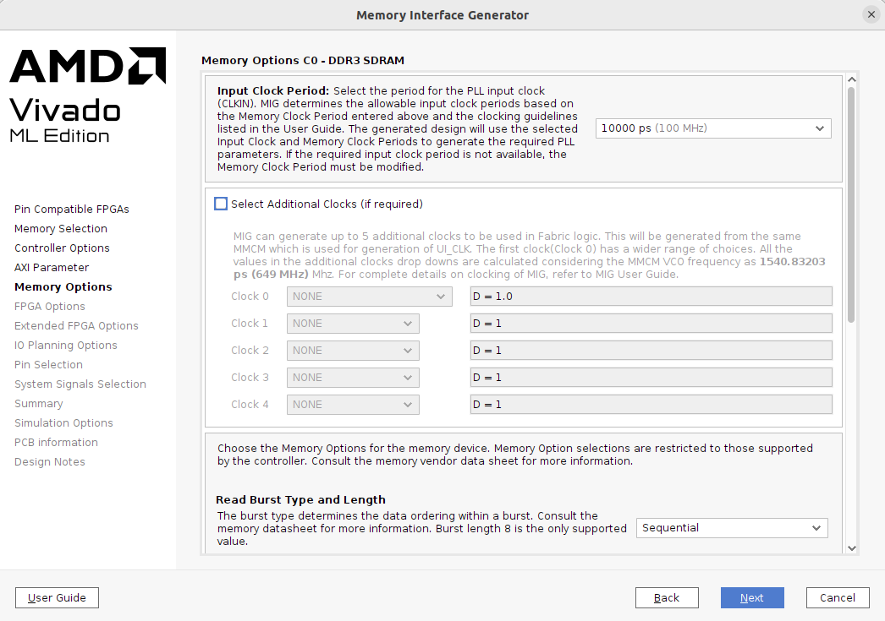
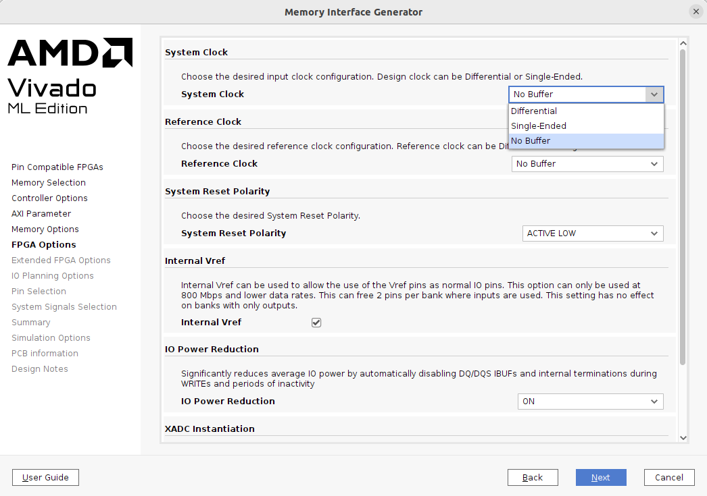

# MIG 7 Series (Memory Interface Generator)

## Important Setup

### 1. Add the MIG from the Board tab

Add the MIG by selecting **External Memory → DDR3 SDRAM** from the **Board**
tab (board: **Arty A7-100**), instead of adding it from the IP catalog. This
way Vivado applies the board preset automatically: memory part, data width,
bank and pin assignment for the on-board DDR3.

### 2. Input clock period and no additional clocks

| Parameter | Value |
| --- | --- |
| Input Clock Period | **10000 ps (100 MHz)** |
| Select Additional Clocks | **unchecked** |
| Read Burst Type | Sequential |

- The input clock is the 100 MHz board clock (after the Utility Buffer).
- **Additional clocks are not generated by the MIG.** All other fabric clocks
  (200 MHz and 25 MHz) are generated by the Clocking Wizard.

### 3. FPGA options: No Buffer for system and reference clock

| Parameter | Value |
| --- | --- |
| System Clock | **No Buffer** |
| Reference Clock | **No Buffer** |
| System Reset Polarity | **ACTIVE LOW** |
| Internal Vref | enabled |
| IO Power Reduction | ON |

- **System Clock = No Buffer**: the 100 MHz clock is already buffered by the
  Utility Buffer (BUFG) and shared with the Clocking Wizard.
- **Reference Clock = No Buffer**: the 200 MHz reference clock comes from the
  Clocking Wizard (`clk_out1`), which is already on the global clock network.
- **System Reset Polarity = ACTIVE LOW**: matches the active-low board reset.

### Configuration summary

Key values from the MIG summary page:

| Category | Parameter | Value |
| --- | --- | --- |
| Device | Target device | xc7a100t-csg324, speed grade -1 |
| Controller | Memory | DDR3 SDRAM |
| | Memory part | MT41K128M16XX-15E (components) |
| | Memory data width | 16 bit |
| | Interface | AXI |
| | Design clock frequency | 3077 ps (≈325 MHz) |
| | PHY to controller clock ratio | 4:1 (`ui_clk` ≈ 81.25 MHz) |
| | ECC | Disabled |
| AXI | Data width | 128 bit |
| | ID width | 4 |
| | Arbitration scheme | RD_PRI_REG |
| | Narrow burst support | 0 |
| Memory options | Burst length | 8 (fixed) |
| | CAS latency | 5 |
| | Address mapping | BANK_ROW_COLUMN |
| FPGA options | XADC instantiation | Enabled |
| Extended FPGA options | DCI for DQ, DQS/DQS#, DM | enabled |
| | Internal termination (HR banks) | 50 Ohms |
| Bank | Bank 34 | T0: DQ[0-7], T1: DQ[8-15], T2/T3: Address/Ctrl |

## Function

- DDR3 memory controller and PHY for the 256 MB DDR3L on the Arty A7-100.
- Acts as the **frame buffer** of the video pipeline: camera frames are
  written into DDR3 and read back for the VGA output.
- Exposes an **AXI4 slave** interface (128-bit data) so the rest of the design
  accesses memory through standard AXI transactions via the SmartConnect.
- Generates `ui_clk` (≈81.25 MHz, 4:1 ratio of the 325 MHz memory clock), the
  clock used by the AXI side of the design, together with `ui_clk_sync_rst`.
- Provides `init_calib_complete`, which indicates that DDR3 calibration has
  finished and the memory is ready for AXI transactions.
- Provides `mmcm_locked`, which indicates the internal MMCM of the MIG is
  stable.

## Connection

### Input Ports

_TBD_

### Output Ports

_TBD_
