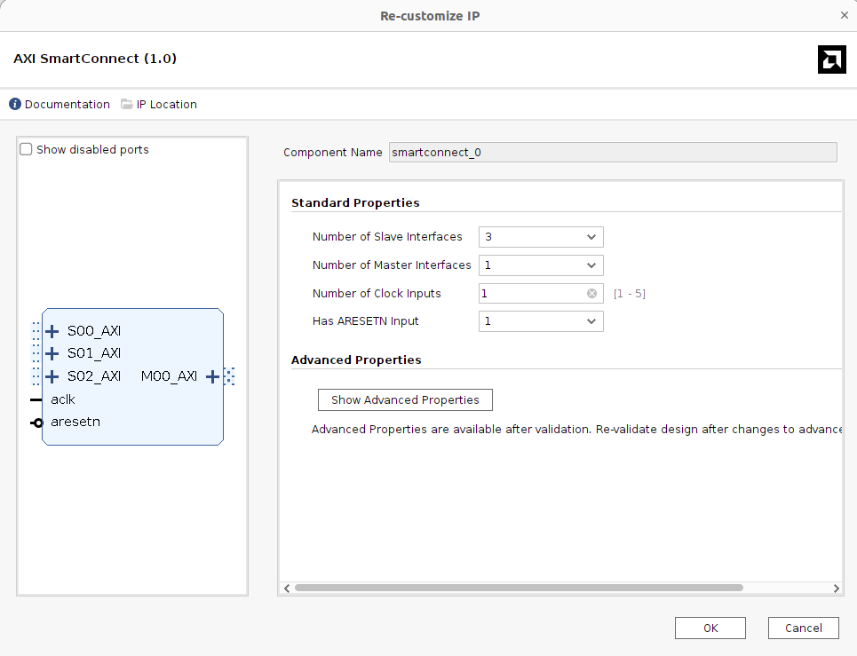

# AXI SmartConnect (smartconnect v1.0)

## Important Setup

| Parameter | Value |
| --- | --- |
| Number of Slave Interfaces | **3** (`S00_AXI`, `S01_AXI`, `S02_AXI`) |
| Number of Master Interfaces | **1** (`M00_AXI`) |
| Number of Clock Inputs | 1 (`aclk`) |
| Has ARESETN Input | 1 (`aresetn`) |

- **3 slave interfaces**: one for each AXI master in the design:
  - JTAG to AXI Master (debug access from the PC),
  - the frame **write** path (`axi_write`),
  - the frame **read** path (`axi_read`).
- **1 master interface**: only one AXI slave, the MIG 7 Series (DDR3).
- **1 clock input**: all AXI masters and the MIG run on the same clock domain
  (MIG `ui_clk`), so no clock conversion is needed inside the SmartConnect.

## Function

- AXI interconnect that lets **multiple AXI masters share one DDR3 memory**
  through the MIG.
- Arbitrates between the write path, the read path and the JTAG debug master.
- Automatically handles differences between the masters and the MIG AXI
  slave, such as:
  - data width conversion (e.g. 32-bit JTAG to AXI → 128-bit MIG),
  - AXI ID width adaptation,
  - protocol conversion if needed.

## Connection

### Input Ports

_TBD_

### Output Ports

_TBD_
