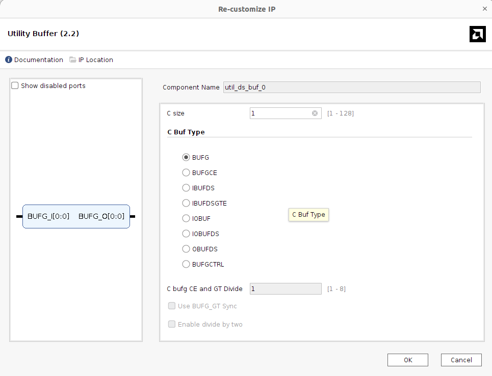

# Utility Buffer (util_ds_buf v2.2)

## Important Setup

| Parameter | Value |
| --- | --- |
| C Size | 1 |
| C Buf Type | **BUFG** |

- **C Buf Type = BUFG**: the IP is used as a global clock buffer, not as a
  differential input buffer (`IBUFDS`). The 100 MHz board oscillator on the
  Arty A7-100 is single-ended (pin `E3`), so only a `BUFG` is needed.
- **C Size = 1**: only one clock signal is buffered.

This setting is needed because both the **Clocking Wizard** and the **MIG 7
Series** are configured with their input clock source set to **No Buffer**.
Since neither IP inserts its own clock buffer, this BUFG is the single place
where the board clock enters the global clock network before it fans out to
both IPs.

## Function

- Takes the 100 MHz board clock and drives it onto the FPGA global clock
  network (BUFG) with low skew.
- Provides one shared, buffered 100 MHz clock for:
  - `clk_in1` of the Clocking Wizard, and
  - `sys_clk_i` of the MIG 7 Series.
- Avoids the conflict that occurs when two IPs each try to place their own
  input buffer on the same clock pin.

## Connection

### Input Ports

_TBD_

### Output Ports

_TBD_
